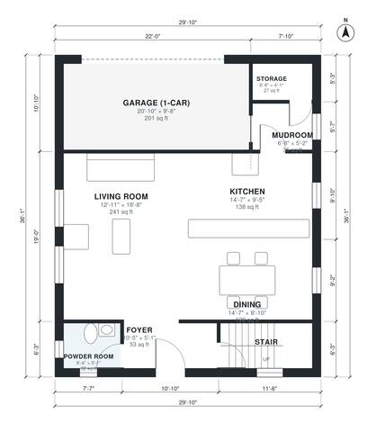

# Narrow Lot House Plans With Garage: 3-Bed, 1,710 Sq Ft

This is a two-story traditional home about 9.1 m (30 ft) wide, with about 160 to 165 m² (roughly 1,700 sq ft) of living space plus a 1-car front garage. The ground floor has a foyer, an open kitchen, dining and living area, a powder room, and a mudroom linking the garage to the kitchen. Upstairs, a primary suite with a walk-in closet and bath, two more bedrooms, a hall bath and a laundry room all open off one hall.

| | |
|---|---|
| Levels | 2 |
| Footprint | 9.1 m × 11.0 m (30 ft × 36 ft) |
| Rooms | 18 indoor, 1 outdoor |
| Indoor area including garage, from the room grid | about 181 m² (1,953 sq ft) |

## Files here

- `area-schedule.csv` (room schedule)
- `building.json` (rooms, walls, openings as data)
- `plan-level1.dxf` (floor plan, DXF, drawing units: inches)
- `plan-level2.dxf` (floor plan, DXF, drawing units: inches)

## More for this plan

- Plan page with the PDF plan set, IFC and 3D model, and a tool to change the plan: https://floorplan.ai-architectures.com/house-plans/narrow-lot-house-plans-with-garage?utm_source=github-plans&utm_medium=probe&utm_campaign=github
- PDF plan set: https://storage.googleapis.com/20img/house-plans/narrow-lot-house-plans-with-garage/plan-set.pdf
- IFC model: https://storage.googleapis.com/20img/house-plans/narrow-lot-house-plans-with-garage/model.ifc

## Known issues in this drawing

- Foyer is 4.9 m² (asked for about 7.0 m²).
- Mudroom is 3.2 m² (asked for about 5.0 m²).
- Hall Bath is only 1.24 m wide.

Concept design generated with AI. Not for construction or permit; verify with a licensed professional.
