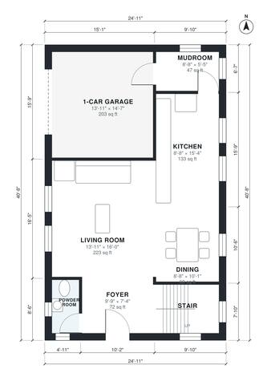

# Narrow Lot House Plans: 3-Bed 2-Story with 1-Car Garage

This is a two-story home on a narrow 25 x 41 ft footprint that fits a 35 ft lot, with about 1,790 sq ft of heated space plus a 1-car garage. Downstairs has an open kitchen, dining and living area with a powder room off the foyer, and the garage enters through a mudroom. Upstairs has a primary suite with a bath and walk-in closet, two more bedrooms, a hall bath and a laundry room, all off one central hall.

| | |
|---|---|
| Levels | 2 |
| Footprint | 7.6 m × 12.4 m (25 ft × 41 ft) |
| Rooms | 17 indoor, 0 outdoor |
| Indoor area including garage, from the room grid | about 188 m² (2,029 sq ft) |

## Files here

- `area-schedule.csv` (room schedule)
- `building.json` (rooms, walls, openings as data)
- `plan-level1.dxf` (floor plan, DXF, drawing units: inches)
- `plan-level2.dxf` (floor plan, DXF, drawing units: inches)

## More for this plan

- Plan page with the PDF plan set, IFC and 3D model, and a tool to change the plan: https://floorplan.ai-architectures.com/house-plans/narrow-lot-house-plans?utm_source=github-plans&utm_medium=probe&utm_campaign=github
- PDF plan set: https://storage.googleapis.com/20img/house-plans/narrow-lot-house-plans/plan-set.pdf
- IFC model: https://storage.googleapis.com/20img/house-plans/narrow-lot-house-plans/model.ifc

## Known issues in this drawing

- None found by the automatic checks.

Concept design generated with AI. Not for construction or permit; verify with a licensed professional.
