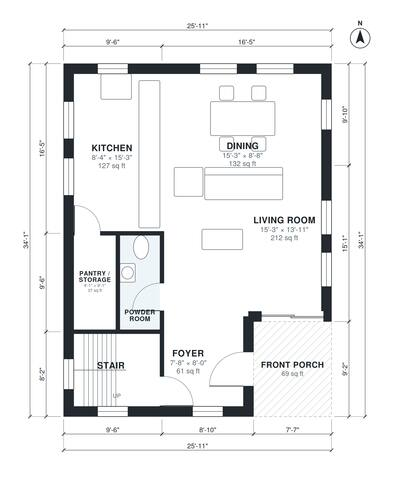

# Narrow Lot Modern House Plans: 3 Bed, 2.5 Bath, 1,700 Sq Ft

A modern two-story home on a narrow 26 ft wide footprint, about 1,766 sq ft in total. The ground floor has a covered porch, a foyer, an open kitchen, dining and living area, a powder room and a pantry. Upstairs, a central hall serves a primary suite with a bath and walk-in closet, two more bedrooms, a hall bath and a laundry room.

| | |
|---|---|
| Levels | 2 |
| Footprint | 7.9 m × 10.4 m (26 ft × 34 ft) |
| Rooms | 16 indoor, 1 outdoor |
| Indoor area including garage, from the room grid | about 158 m² (1,699 sq ft) |

## Files here

- `area-schedule.csv` (room schedule)
- `building.json` (rooms, walls, openings as data)
- `plan-level1.dxf` (floor plan, DXF, drawing units: inches)
- `plan-level2.dxf` (floor plan, DXF, drawing units: inches)

## More for this plan

- Plan page with the PDF plan set, IFC and 3D model, and a tool to change the plan: https://floorplan.ai-architectures.com/house-plans/narrow-lot-modern-house-plans?utm_source=github-plans&utm_medium=probe&utm_campaign=github
- PDF plan set: https://storage.googleapis.com/20img/house-plans/narrow-lot-modern-house-plans/plan-set.pdf
- IFC model: https://storage.googleapis.com/20img/house-plans/narrow-lot-modern-house-plans/model.ifc

## Known issues in this drawing

- Foyer and Powder Room are not directly connected.

Concept design generated with AI. Not for construction or permit; verify with a licensed professional.
