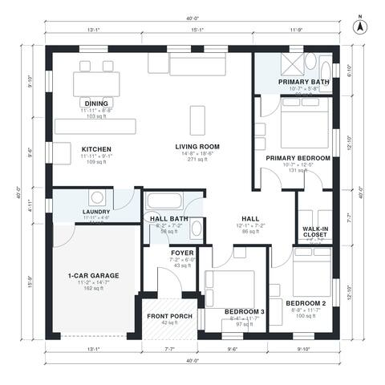

# Narrow Lot One Story House Plans: 3 Bed, 2 Bath, 1,350 Sq Ft

A single-story ranch of about 1,340 sq ft of living space (plus a 1-car garage and porch) inside a 40 x 40 ft envelope. A large open kitchen, dining and living area faces the rear. Three bedrooms sit in a private wing, with the primary suite at the end, and the laundry doubles as a mudroom from the front garage.

| | |
|---|---|
| Levels | 1 |
| Footprint | 12.19 m × 12.19 m (40 ft × 40 ft) |
| Rooms | 13 indoor, 1 outdoor |
| Indoor area including garage, from the room grid | about 145 m² (1,557 sq ft) |

## Files here

- `area-schedule.csv` (room schedule)
- `building.json` (rooms, walls, openings as data)
- `plan-level1.dxf` (floor plan, DXF, drawing units: inches)

## More for this plan

- Plan page with the PDF plan set, IFC and 3D model, and a tool to change the plan: https://floorplan.ai-architectures.com/house-plans/narrow-lot-one-story-house-plans?utm_source=github-plans&utm_medium=probe&utm_campaign=github
- PDF plan set: https://storage.googleapis.com/20img/house-plans/narrow-lot-one-story-house-plans/plan-set.pdf
- IFC model: https://storage.googleapis.com/20img/house-plans/narrow-lot-one-story-house-plans/model.ifc

## Known issues in this drawing

- Kitchen is 10.1 m² (asked for about 14.0 m²).

Concept design generated with AI. Not for construction or permit; verify with a licensed professional.
