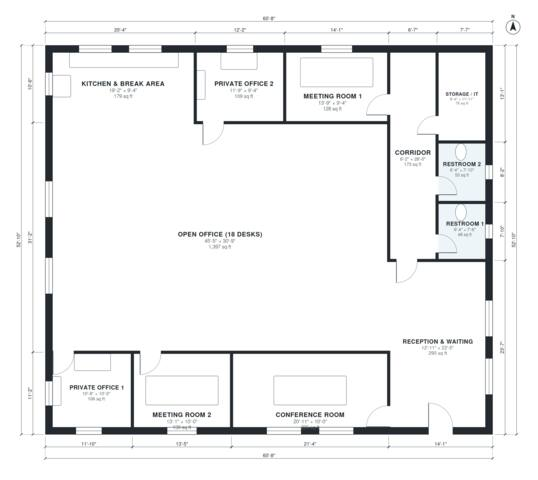

# Small Office Floor Plans: 3,210 Sq Ft Single-Level Layout

This single-storey office is about 3,200 sq ft (297 m²) and is built around a large open workspace for 18 desks. Reception opens directly into the workspace, with the conference room beside it. A service corridor holds the restrooms, storage/IT and one meeting room. The kitchen and break area is open to the workspace, and the two private offices and a second meeting room sit along the edges.

| | |
|---|---|
| Levels | 1 |
| Footprint | 18.5 m × 16.1 m (61 ft × 53 ft) |
| Rooms | 12 indoor, 0 outdoor |
| Indoor area including garage, from the room grid | about 298 m² (3,206 sq ft) |

## Files here

- `building.json` (rooms, walls, openings as data)
- `plan-level1.dxf` (floor plan, DXF, drawing units: inches)

## More for this plan

- Plan page with the PDF plan set, IFC and 3D model, and a tool to change the plan: https://floorplan.ai-architectures.com/house-plans/office-floor-plans?utm_source=github-plans&utm_medium=probe&utm_campaign=github
- PDF plan set: https://storage.googleapis.com/20img/house-plans/office-floor-plans/plan-set.pdf
- IFC model: https://storage.googleapis.com/20img/house-plans/office-floor-plans/model.ifc

## Known issues in this drawing

- None found by the automatic checks.

Concept design generated with AI. Not for construction or permit; verify with a licensed professional.
