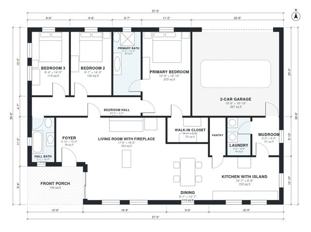

# One Story Craftsman House Plans: 3 Bed, 2 Bath, 1,760 Sq Ft

This single-storey craftsman home has about 168 m² (roughly 1,800 sq ft) of living space, plus a 2-car garage and a front porch. The foyer opens into a large living room with a fireplace, which flows into the dining area and an island kitchen with a pantry. The garage enters through a mudroom beside the laundry. A bedroom wing holds the primary suite, with its own bath and walk-in closet, and two secondary bedrooms that share a hall bath.

| | |
|---|---|
| Levels | 1 |
| Footprint | 17.5 m × 12.1 m (57 ft × 40 ft) |
| Rooms | 15 indoor, 1 outdoor |
| Indoor area including garage, from the room grid | about 202 m² (2,173 sq ft) |

## Files here

- `area-schedule.csv` (room schedule)
- `building.json` (rooms, walls, openings as data)
- `plan-level1.dxf` (floor plan, DXF, drawing units: inches)

## More for this plan

- Plan page with the PDF plan set, IFC and 3D model, and a tool to change the plan: https://floorplan.ai-architectures.com/house-plans/one-story-craftsman-house-plans?utm_source=github-plans&utm_medium=probe&utm_campaign=github
- PDF plan set: https://storage.googleapis.com/20img/house-plans/one-story-craftsman-house-plans/plan-set.pdf
- IFC model: https://storage.googleapis.com/20img/house-plans/one-story-craftsman-house-plans/model.ifc

## Known issues in this drawing

- None found by the automatic checks.

Concept design generated with AI. Not for construction or permit; verify with a licensed professional.
