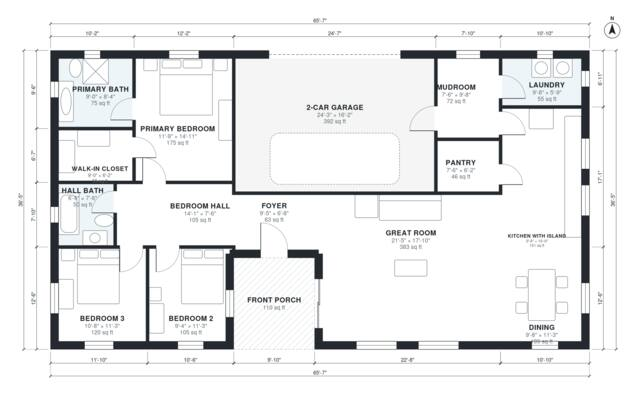

# One Story Farmhouse Plans: 3 Bed, 2 Bath, 1,850 Sq Ft

This is a single-story modern farmhouse with about 1,850 sq ft of living space. The garage and front porch come on top of that. It has an open great room, kitchen with island and dining area, a pantry, and a mudroom and laundry between the kitchen and the 2-car garage. The three bedrooms sit in a quiet wing off a central hall, and the primary suite has its own bath and walk-in closet.

| | |
|---|---|
| Levels | 1 |
| Footprint | 20.0 m × 11.1 m (66 ft × 36 ft) |
| Rooms | 15 indoor, 1 outdoor |
| Indoor area including garage, from the room grid | about 212 m² (2,280 sq ft) |

## Files here

- `area-schedule.csv` (room schedule)
- `building.json` (rooms, walls, openings as data)
- `plan-level1.dxf` (floor plan, DXF, drawing units: inches)

## More for this plan

- Plan page with the PDF plan set, IFC and 3D model, and a tool to change the plan: https://floorplan.ai-architectures.com/house-plans/one-story-farmhouse-plans?utm_source=github-plans&utm_medium=probe&utm_campaign=github
- PDF plan set: https://storage.googleapis.com/20img/house-plans/one-story-farmhouse-plans/plan-set.pdf
- IFC model: https://storage.googleapis.com/20img/house-plans/one-story-farmhouse-plans/model.ifc

## Known issues in this drawing

- None found by the automatic checks.

Concept design generated with AI. Not for construction or permit; verify with a licensed professional.
