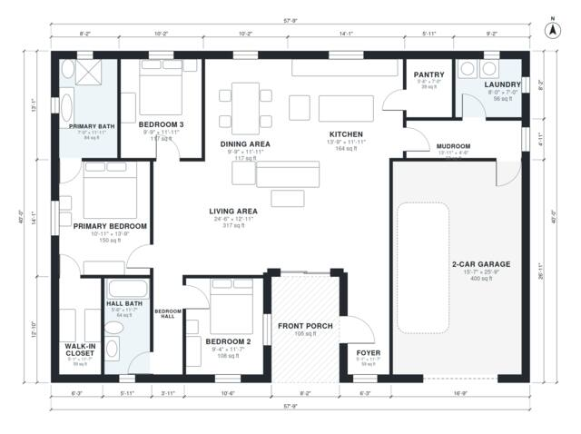

# One Story House Plans With Open Floor Plan | 3 Bed, 2 Bath

This is a single-story, 3-bedroom, 2-bath home with about 164 m² (1,765 sq ft) of living space. The attached 2-car garage and covered front porch bring the footprint to about 214 m². A large open kitchen, dining and living room sits at the centre. The primary suite with its bath and walk-in closet and the two bedrooms with a shared hall bath are grouped on one side. The garage connects through a mudroom and laundry, and there is a pantry off the kitchen.

| | |
|---|---|
| Levels | 1 |
| Footprint | 17.6 m × 12.2 m (58 ft × 40 ft) |
| Rooms | 15 indoor, 1 outdoor |
| Indoor area including garage, from the room grid | about 205 m² (2,206 sq ft) |

## Files here

- `area-schedule.csv` (room schedule)
- `building.json` (rooms, walls, openings as data)
- `plan-level1.dxf` (floor plan, DXF, drawing units: inches)

## More for this plan

- Plan page with the PDF plan set, IFC and 3D model, and a tool to change the plan: https://floorplan.ai-architectures.com/house-plans/one-story-house-plans-with-open-floor-plan?utm_source=github-plans&utm_medium=probe&utm_campaign=github
- PDF plan set: https://storage.googleapis.com/20img/house-plans/one-story-house-plans-with-open-floor-plan/plan-set.pdf
- IFC model: https://storage.googleapis.com/20img/house-plans/one-story-house-plans-with-open-floor-plan/model.ifc

## Known issues in this drawing

- None found by the automatic checks.

Concept design generated with AI. Not for construction or permit; verify with a licensed professional.
