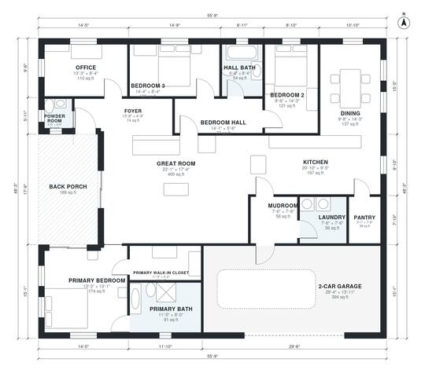

# One Story House Plans: 3 Bed, 2.5 Bath, 2,080 Sq Ft Design

This one-story modern farmhouse is about 2,100 sq ft of heated space, plus a 2-car garage and a covered back porch. The foyer opens into a large great room that flows into the kitchen and dining area, with an office and powder room by the entry. The primary suite, with its bath and walk-in closet, is on its own side of the house. Bedrooms 2 and 3 share a hall bath off a short bedroom hall, and a mudroom, laundry and pantry link the garage to the kitchen.

| | |
|---|---|
| Levels | 1 |
| Footprint | 17.0 m × 14.7 m (56 ft × 48 ft) |
| Rooms | 17 indoor, 1 outdoor |
| Indoor area including garage, from the room grid | about 234 m² (2,521 sq ft) |

## Files here

- `area-schedule.csv` (room schedule)
- `building.json` (rooms, walls, openings as data)
- `plan-level1.dxf` (floor plan, DXF, drawing units: inches)

## More for this plan

- Plan page with the PDF plan set, IFC and 3D model, and a tool to change the plan: https://floorplan.ai-architectures.com/house-plans/one-story-house-plans?utm_source=github-plans&utm_medium=probe&utm_campaign=github
- PDF plan set: https://storage.googleapis.com/20img/house-plans/one-story-house-plans/plan-set.pdf
- IFC model: https://storage.googleapis.com/20img/house-plans/one-story-house-plans/model.ifc

## Known issues in this drawing

- Powder Room is 1.9 m² (asked for about 3.0 m²).

Concept design generated with AI. Not for construction or permit; verify with a licensed professional.
