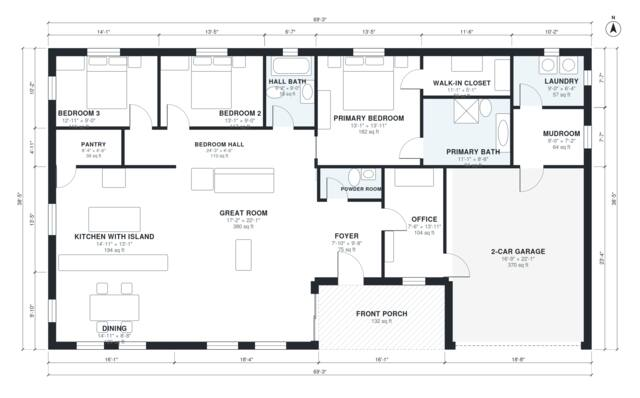

# One Story Modern Farmhouse Plans: 3 Bed, 2,090 Sq Ft Layout

This is a single-story modern farmhouse of about 195 m² (2,100 sq ft) of living space, plus a 2-car garage and a front porch. The porch opens to a foyer and a large open great room, kitchen with island and dining area. The three bedrooms are in a separate wing, with a primary suite that has a bath and walk-in closet. The mudroom, laundry and pantry sit between the kitchen and the garage.

| | |
|---|---|
| Levels | 1 |
| Footprint | 21.1 m × 11.7 m (69 ft × 38 ft) |
| Rooms | 17 indoor, 1 outdoor |
| Indoor area including garage, from the room grid | about 235 m² (2,525 sq ft) |

## Files here

- `area-schedule.csv` (room schedule)
- `building.json` (rooms, walls, openings as data)
- `plan-level1.dxf` (floor plan, DXF, drawing units: inches)

## More for this plan

- Plan page with the PDF plan set, IFC and 3D model, and a tool to change the plan: https://floorplan.ai-architectures.com/house-plans/one-story-modern-farmhouse-plans?utm_source=github-plans&utm_medium=probe&utm_campaign=github
- PDF plan set: https://storage.googleapis.com/20img/house-plans/one-story-modern-farmhouse-plans/plan-set.pdf
- IFC model: https://storage.googleapis.com/20img/house-plans/one-story-modern-farmhouse-plans/model.ifc

## Known issues in this drawing

- Kitchen with Island and Mudroom are not directly connected.

Concept design generated with AI. Not for construction or permit; verify with a licensed professional.
