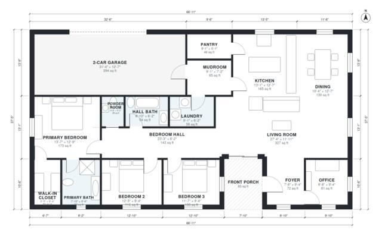

# One Story Modern House Plans: 3 Bed, 1,970 Sq Ft Layout

This is a single-story modern home with about 2,000 sq ft of living space plus a 2-car garage and front porch. The open kitchen, dining and living area is at the center, with the office by the entry. The three bedrooms are grouped off a hall, including a primary suite with a bath and walk-in closet. The garage enters through a mudroom beside the laundry and pantry.

| | |
|---|---|
| Levels | 1 |
| Footprint | 20.4 m × 11.4 m (67 ft × 37 ft) |
| Rooms | 17 indoor, 1 outdoor |
| Indoor area including garage, from the room grid | about 225 m² (2,421 sq ft) |

## Files here

- `area-schedule.csv` (room schedule)
- `building.json` (rooms, walls, openings as data)
- `plan-level1.dxf` (floor plan, DXF, drawing units: inches)

## More for this plan

- Plan page with the PDF plan set, IFC and 3D model, and a tool to change the plan: https://floorplan.ai-architectures.com/house-plans/one-story-modern-house-plans?utm_source=github-plans&utm_medium=probe&utm_campaign=github
- PDF plan set: https://storage.googleapis.com/20img/house-plans/one-story-modern-house-plans/plan-set.pdf
- IFC model: https://storage.googleapis.com/20img/house-plans/one-story-modern-house-plans/model.ifc

## Known issues in this drawing

- Office is 7.5 m² (asked for about 11.0 m²).
- Living Room is only 3.64 m wide.

Concept design generated with AI. Not for construction or permit; verify with a licensed professional.
