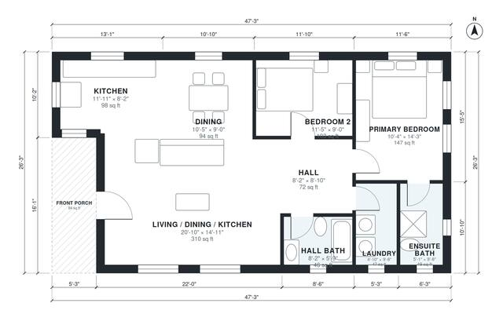

# Open Concept 2 Bedroom House Plans: 1,160 Sq Ft, 2 Bath

This is a compact single-story ranch of about 102 m² (1,100 sq ft) of living space, plus a front porch. The porch opens into a bright open kitchen, dining and living room. A short hall leads to the primary bedroom with its own ensuite, a second bedroom, a hall bath and the laundry.

| | |
|---|---|
| Levels | 1 |
| Footprint | 14.4 m × 8.0 m (47 ft × 26 ft) |
| Rooms | 9 indoor, 1 outdoor |
| Indoor area including garage, from the room grid | about 107 m² (1,156 sq ft) |

## Files here

- `area-schedule.csv` (room schedule)
- `building.json` (rooms, walls, openings as data)
- `plan-level1.dxf` (floor plan, DXF, drawing units: inches)

## More for this plan

- Plan page with the PDF plan set, IFC and 3D model, and a tool to change the plan: https://floorplan.ai-architectures.com/house-plans/open-concept-2-bedroom-house-plans?utm_source=github-plans&utm_medium=probe&utm_campaign=github
- PDF plan set: https://storage.googleapis.com/20img/house-plans/open-concept-2-bedroom-house-plans/plan-set.pdf
- IFC model: https://storage.googleapis.com/20img/house-plans/open-concept-2-bedroom-house-plans/model.ifc

## Known issues in this drawing

- None found by the automatic checks.

Concept design generated with AI. Not for construction or permit; verify with a licensed professional.
