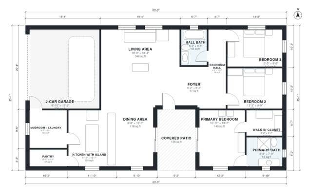

# Open Concept 3 Bedroom House Plans | 1,710 Sq Ft One-Story

This is a single-story, 3-bedroom, 2-bath ranch of roughly 153 m² (about 1,650 sq ft) of living space. It also has an attached 2-car garage and a covered patio. The open great room combines the kitchen island, dining and living areas. The primary suite with its bath and walk-in closet is separated from the two secondary bedrooms and the hall bath, and the garage connects through a mudroom/laundry.

| | |
|---|---|
| Levels | 1 |
| Footprint | 19.2 m × 10.7 m (63 ft × 35 ft) |
| Rooms | 14 indoor, 1 outdoor |
| Indoor area including garage, from the room grid | about 193 m² (2,076 sq ft) |

## Files here

- `area-schedule.csv` (room schedule)
- `building.json` (rooms, walls, openings as data)
- `plan-level1.dxf` (floor plan, DXF, drawing units: inches)

## More for this plan

- Plan page with the PDF plan set, IFC and 3D model, and a tool to change the plan: https://floorplan.ai-architectures.com/house-plans/open-concept-3-bedroom-house-plans?utm_source=github-plans&utm_medium=probe&utm_campaign=github
- PDF plan set: https://storage.googleapis.com/20img/house-plans/open-concept-3-bedroom-house-plans/plan-set.pdf
- IFC model: https://storage.googleapis.com/20img/house-plans/open-concept-3-bedroom-house-plans/model.ifc

## Known issues in this drawing

- Primary Bath is 5.6 m² (asked for about 8.0 m²).

Concept design generated with AI. Not for construction or permit; verify with a licensed professional.
