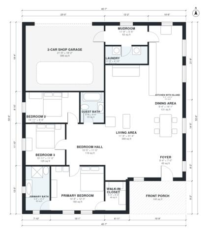

# Open Concept Barndominium Floor Plans: 1,850 Sq Ft, 3 Bed

This single-level barndominium has about 186 m² (2,000 sq ft) of living space, plus a 2-car shop garage and a front porch. The kitchen with island, dining and living areas form one open great room. The three bedrooms sit together off a hall, and the primary suite has its own bath and walk-in closet. A mudroom and laundry link the garage to the kitchen.

| | |
|---|---|
| Levels | 1 |
| Footprint | 13.9 m × 16.3 m (46 ft × 53 ft) |
| Rooms | 14 indoor, 1 outdoor |
| Indoor area including garage, from the room grid | about 213 m² (2,294 sq ft) |

## Files here

- `area-schedule.csv` (room schedule)
- `building.json` (rooms, walls, openings as data)
- `plan-level1.dxf` (floor plan, DXF, drawing units: inches)

## More for this plan

- Plan page with the PDF plan set, IFC and 3D model, and a tool to change the plan: https://floorplan.ai-architectures.com/house-plans/open-concept-barndominium-floor-plans?utm_source=github-plans&utm_medium=probe&utm_campaign=github
- PDF plan set: https://storage.googleapis.com/20img/house-plans/open-concept-barndominium-floor-plans/plan-set.pdf
- IFC model: https://storage.googleapis.com/20img/house-plans/open-concept-barndominium-floor-plans/model.ifc

## Known issues in this drawing

- Walk-in Closet is 4.2 m² (asked for about 6.0 m²).

Concept design generated with AI. Not for construction or permit; verify with a licensed professional.
