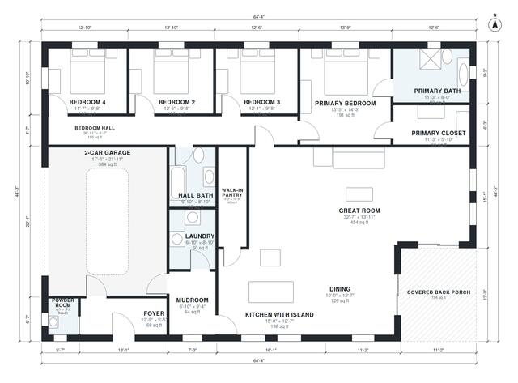

# Open Concept Farmhouse Plans: 4 Bed, 2,280 Sq Ft Single Story

This is a single-story modern farmhouse of about 265 m² overall, with roughly 211 m² (2,270 sq ft) of living space plus the garage and covered back porch. A large open great room with kitchen island, dining and walk-in pantry sits at the heart of the plan, with a mudroom and laundry linking to the 2-car garage. The four bedrooms are grouped in a quiet wing off a hall, and the primary suite has its own bath and walk-in closet.

| | |
|---|---|
| Levels | 1 |
| Footprint | 19.6 m × 13.5 m (64 ft × 44 ft) |
| Rooms | 17 indoor, 1 outdoor |
| Indoor area including garage, from the room grid | about 250 m² (2,694 sq ft) |

## Files here

- `area-schedule.csv` (room schedule)
- `building.json` (rooms, walls, openings as data)
- `plan-level1.dxf` (floor plan, DXF, drawing units: inches)

## More for this plan

- Plan page with the PDF plan set, IFC and 3D model, and a tool to change the plan: https://floorplan.ai-architectures.com/house-plans/open-concept-farmhouse-plans?utm_source=github-plans&utm_medium=probe&utm_campaign=github
- PDF plan set: https://storage.googleapis.com/20img/house-plans/open-concept-farmhouse-plans/plan-set.pdf
- IFC model: https://storage.googleapis.com/20img/house-plans/open-concept-farmhouse-plans/model.ifc

## Known issues in this drawing

- Powder Room is 2.2 m² (asked for about 3.5 m²).

Concept design generated with AI. Not for construction or permit; verify with a licensed professional.
