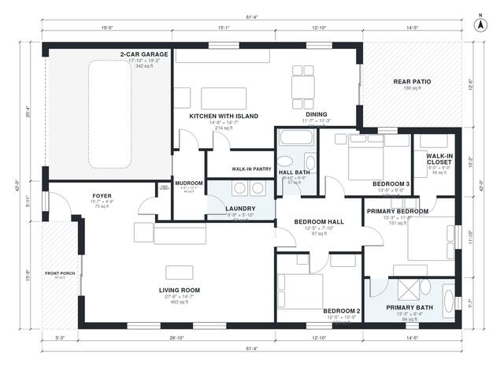

# Open Concept Floor Plans: 3-Bed One-Story Home, 1,930 sq ft

This is a single-story, open-concept farmhouse of about 1,900 sq ft of heated space, plus a 2-car garage, front porch and rear patio. One large kitchen, dining and living area with an island sits at the center, with a walk-in pantry and a mudroom/laundry between the kitchen and garage. The primary suite is at the back with its own bath and walk-in closet. Two more bedrooms and a shared bath sit off a private hall on the east side.

| | |
|---|---|
| Levels | 1 |
| Footprint | 18.7 m × 12.8 m (61 ft × 42 ft) |
| Rooms | 16 indoor, 2 outdoor |
| Indoor area including garage, from the room grid | about 215 m² (2,314 sq ft) |

## Files here

- `area-schedule.csv` (room schedule)
- `building.json` (rooms, walls, openings as data)
- `plan-level1.dxf` (floor plan, DXF, drawing units: inches)

## More for this plan

- Plan page with the PDF plan set, IFC and 3D model, and a tool to change the plan: https://floorplan.ai-architectures.com/house-plans/open-concept-floor-plans?utm_source=github-plans&utm_medium=probe&utm_campaign=github
- PDF plan set: https://storage.googleapis.com/20img/house-plans/open-concept-floor-plans/plan-set.pdf
- IFC model: https://storage.googleapis.com/20img/house-plans/open-concept-floor-plans/model.ifc

## Known issues in this drawing

- Living Room is only 4.44 m wide.
- 2-Car Garage is only 5.44 m wide.

Concept design generated with AI. Not for construction or permit; verify with a licensed professional.
