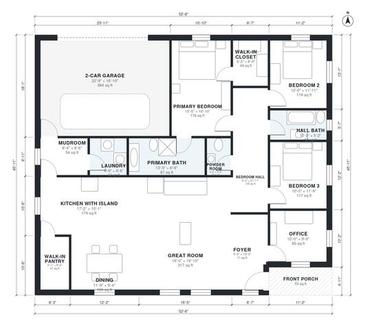

# Open Concept House Plans With Island: 3 Bed, 1,920 Sq Ft

A single-storey, roughly 185 m² (2,000 sq ft) modern farmhouse. The kitchen island opens to the dining area and a large great room. The primary suite and two bedrooms sit in a private wing off the hall, and the office is at the front by the entry. The 2-car garage (about 40 m², not counted in the living area) enters through a mudroom beside the laundry, and the walk-in pantry is next to the kitchen.

| | |
|---|---|
| Levels | 1 |
| Footprint | 16.0 m × 14.0 m (52 ft × 46 ft) |
| Rooms | 17 indoor, 1 outdoor |
| Indoor area including garage, from the room grid | about 219 m² (2,356 sq ft) |

## Files here

- `area-schedule.csv` (room schedule)
- `building.json` (rooms, walls, openings as data)
- `plan-level1.dxf` (floor plan, DXF, drawing units: inches)

## More for this plan

- Plan page with the PDF plan set, IFC and 3D model, and a tool to change the plan: https://floorplan.ai-architectures.com/house-plans/open-concept-house-plans-with-island?utm_source=github-plans&utm_medium=probe&utm_campaign=github
- PDF plan set: https://storage.googleapis.com/20img/house-plans/open-concept-house-plans-with-island/plan-set.pdf
- IFC model: https://storage.googleapis.com/20img/house-plans/open-concept-house-plans-with-island/model.ifc

## Known issues in this drawing

- None found by the automatic checks.

Concept design generated with AI. Not for construction or permit; verify with a licensed professional.
