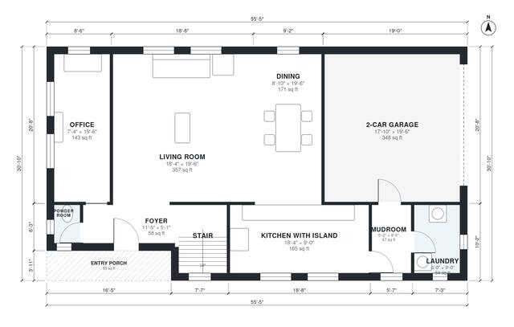

# Open Concept Modern House Plans: 4 Bed, 2,510 Sq Ft Two-Story

This is a two-story modern home of about 235 m² (roughly 2,550 sq ft) of living space, plus a 2-car garage. The ground floor has an open kitchen with island, dining and living area with large glazing, an office, powder room, laundry and mudroom. Upstairs are the primary suite with ensuite and walk-in closet, three more bedrooms and a hall bath, all off one central hall.

| | |
|---|---|
| Levels | 2 |
| Footprint | 16.9 m × 9.4 m (55 ft × 31 ft) |
| Rooms | 19 indoor, 2 outdoor |
| Indoor area including garage, from the room grid | about 269 m² (2,900 sq ft) |

## Files here

- `area-schedule.csv` (room schedule)
- `building.json` (rooms, walls, openings as data)
- `plan-level1.dxf` (floor plan, DXF, drawing units: inches)
- `plan-level2.dxf` (floor plan, DXF, drawing units: inches)

## More for this plan

- Plan page with the PDF plan set, IFC and 3D model, and a tool to change the plan: https://floorplan.ai-architectures.com/house-plans/open-concept-modern-house-plans?utm_source=github-plans&utm_medium=probe&utm_campaign=github
- PDF plan set: https://storage.googleapis.com/20img/house-plans/open-concept-modern-house-plans/plan-set.pdf
- IFC model: https://storage.googleapis.com/20img/house-plans/open-concept-modern-house-plans/model.ifc

## Known issues in this drawing

- Powder Room is 1.6 m² (asked for about 3.5 m²).
- Foyer is 5.4 m² (asked for about 8.0 m²).

Concept design generated with AI. Not for construction or permit; verify with a licensed professional.
