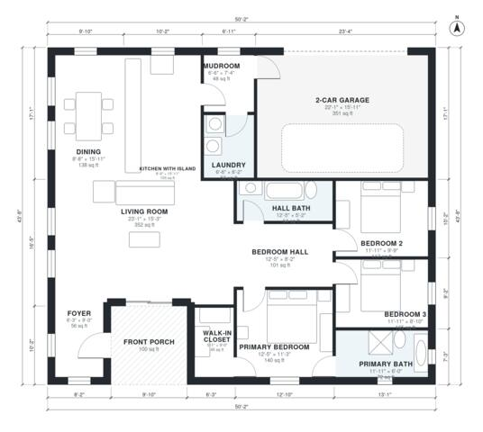

# Open Concept Ranch House Plans: 3 Bed, 2 Bath, 1,690 Sq Ft

This is a single-story ranch with about 160 m² (roughly 1,700 sq ft) of living space, plus a 2-car garage and a front porch. The kitchen with island, dining and living form one large open room, and a bedroom wing holds three bedrooms, a hall bath and a primary suite with a bath and walk-in closet. The garage enters through a mudroom beside the laundry.

| | |
|---|---|
| Levels | 1 |
| Footprint | 15.3 m × 13.3 m (50 ft × 44 ft) |
| Rooms | 14 indoor, 1 outdoor |
| Indoor area including garage, from the room grid | about 194 m² (2,090 sq ft) |

## Files here

- `area-schedule.csv` (room schedule)
- `building.json` (rooms, walls, openings as data)
- `plan-level1.dxf` (floor plan, DXF, drawing units: inches)

## More for this plan

- Plan page with the PDF plan set, IFC and 3D model, and a tool to change the plan: https://floorplan.ai-architectures.com/house-plans/open-concept-ranch-house-plans?utm_source=github-plans&utm_medium=probe&utm_campaign=github
- PDF plan set: https://storage.googleapis.com/20img/house-plans/open-concept-ranch-house-plans/plan-set.pdf
- IFC model: https://storage.googleapis.com/20img/house-plans/open-concept-ranch-house-plans/model.ifc

## Known issues in this drawing

- Foyer is 5.2 m² (asked for about 8.0 m²).

Concept design generated with AI. Not for construction or permit; verify with a licensed professional.
