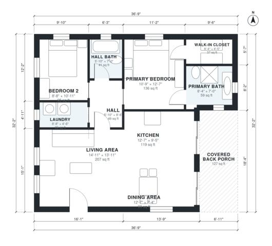

# Open Floor Plan Small Homes: 2 Bed 2 Bath, 1,050 Sq Ft

This is a compact one-story home of about 98 m² (roughly 1,050 sq ft) indoors, plus a 12 m² covered back porch. The kitchen, dining and living areas share one open great room that opens through sliding doors onto the porch. A short hall at the back leads to the primary suite (ensuite and walk-in closet), a second bedroom, a hall bath and the laundry.

| | |
|---|---|
| Levels | 1 |
| Footprint | 11.2 m × 9.8 m (37 ft × 32 ft) |
| Rooms | 10 indoor, 1 outdoor |
| Indoor area including garage, from the room grid | about 98 m² (1,055 sq ft) |

## Files here

- `area-schedule.csv` (room schedule)
- `building.json` (rooms, walls, openings as data)
- `plan-level1.dxf` (floor plan, DXF, drawing units: inches)

## More for this plan

- Plan page with the PDF plan set, IFC and 3D model, and a tool to change the plan: https://floorplan.ai-architectures.com/house-plans/open-floor-plan-small-homes?utm_source=github-plans&utm_medium=probe&utm_campaign=github
- PDF plan set: https://storage.googleapis.com/20img/house-plans/open-floor-plan-small-homes/plan-set.pdf
- IFC model: https://storage.googleapis.com/20img/house-plans/open-floor-plan-small-homes/model.ifc

## Known issues in this drawing

- Dining Area is only 2.24 m wide.

Concept design generated with AI. Not for construction or permit; verify with a licensed professional.
