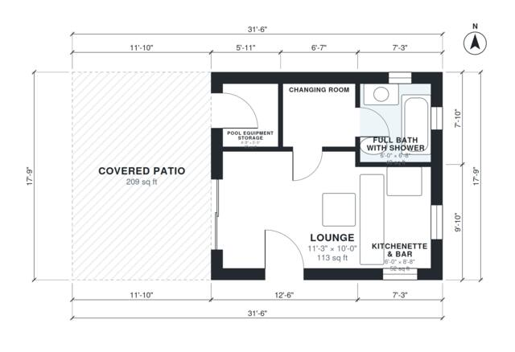

# Pool House Plans With Bathroom: 350 Sq Ft Single-Level Design

This is a compact pool house of about 350 sq ft (32 m²) indoors, with a 209 sq ft covered patio alongside. The lounge is open to a kitchenette and bar and opens onto the patio through a wide sliding door. A changing room leads to a full bath with a shower, and a pool equipment storage room opens directly onto the patio.

| | |
|---|---|
| Levels | 1 |
| Footprint | 9.6 m × 5.4 m (31 ft × 18 ft) |
| Rooms | 5 indoor, 1 outdoor |
| Indoor area including garage, from the room grid | about 32 m² (349 sq ft) |

## Files here

- `area-schedule.csv` (room schedule)
- `building.json` (rooms, walls, openings as data)
- `plan-level1.dxf` (floor plan, DXF, drawing units: inches)

## More for this plan

- Plan page with the PDF plan set, IFC and 3D model, and a tool to change the plan: https://floorplan.ai-architectures.com/house-plans/pool-house-plans-with-bathroom?utm_source=github-plans&utm_medium=probe&utm_campaign=github
- PDF plan set: https://storage.googleapis.com/20img/house-plans/pool-house-plans-with-bathroom/plan-set.pdf
- IFC model: https://storage.googleapis.com/20img/house-plans/pool-house-plans-with-bathroom/model.ifc

## Known issues in this drawing

- Pool Equipment Storage is 2.4 m² (asked for about 4.0 m²).

Concept design generated with AI. Not for construction or permit; verify with a licensed professional.
