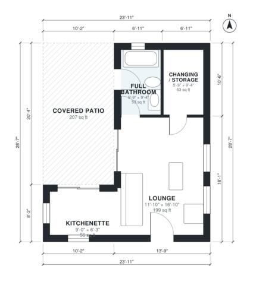

# Pool House Plans: 480 Sq Ft One-Story Cabana with Patio

A compact one-story cabana of about 45 m² (about 485 sq ft) enclosed, plus a 22 m² covered patio along the pool side. It has an open lounge with a kitchenette, a full bathroom with its own door to the patio, and a changing and storage room. The revised proportions make the kitchenette a usable size and let the whole lounge face the pool.

| | |
|---|---|
| Levels | 1 |
| Footprint | 7.3 m × 8.7 m (24 ft × 29 ft) |
| Rooms | 4 indoor, 1 outdoor |
| Indoor area including garage, from the room grid | about 44 m² (477 sq ft) |

## Files here

- `building.json` (rooms, walls, openings as data)
- `plan-level1.dxf` (floor plan, DXF, drawing units: inches)

## More for this plan

- Plan page with the PDF plan set, IFC and 3D model, and a tool to change the plan: https://floorplan.ai-architectures.com/house-plans/pool-house-plans?utm_source=github-plans&utm_medium=probe&utm_campaign=github
- PDF plan set: https://storage.googleapis.com/20img/house-plans/pool-house-plans/plan-set.pdf
- IFC model: https://storage.googleapis.com/20img/house-plans/pool-house-plans/model.ifc

## Known issues in this drawing

- Kitchenette is 5.2 m² (asked for about 8.0 m²).
- Kitchenette is only 1.90 m wide.

Concept design generated with AI. Not for construction or permit; verify with a licensed professional.
