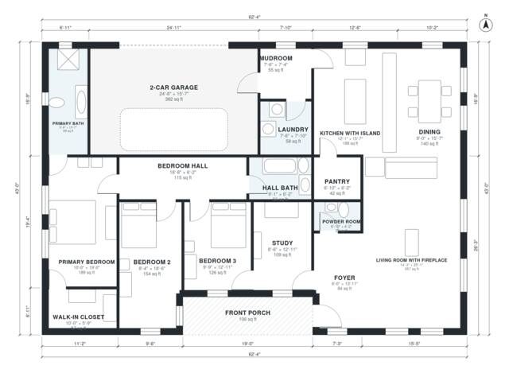

# Prairie Style House Plans: 3-Bed, 2,160 Sq Ft One-Story

This is a single-story prairie-style home of about 204 m² (2,200 sq ft) of living space, plus a 2-car garage and a front porch. It has an open living, dining and kitchen core with a fireplace, a kitchen island and a pantry. The bedroom wing holds a primary suite with walk-in closet and two further bedrooms, and the study sits off the foyer. The revision connects the bedroom hall directly to the living area so the bedrooms are reached without crossing another bedroom. It also gives the garage and powder room their full sizes.

| | |
|---|---|
| Levels | 1 |
| Footprint | 19.0 m × 13.1 m (62 ft × 43 ft) |
| Rooms | 17 indoor, 1 outdoor |
| Indoor area including garage, from the room grid | about 239 m² (2,573 sq ft) |

## Files here

- `area-schedule.csv` (room schedule)
- `building.json` (rooms, walls, openings as data)
- `plan-level1.dxf` (floor plan, DXF, drawing units: inches)

## More for this plan

- Plan page with the PDF plan set, IFC and 3D model, and a tool to change the plan: https://floorplan.ai-architectures.com/house-plans/prairie-style-house-plans?utm_source=github-plans&utm_medium=probe&utm_campaign=github
- PDF plan set: https://storage.googleapis.com/20img/house-plans/prairie-style-house-plans/plan-set.pdf
- IFC model: https://storage.googleapis.com/20img/house-plans/prairie-style-house-plans/model.ifc

## Known issues in this drawing

- None found by the automatic checks.

Concept design generated with AI. Not for construction or permit; verify with a licensed professional.
