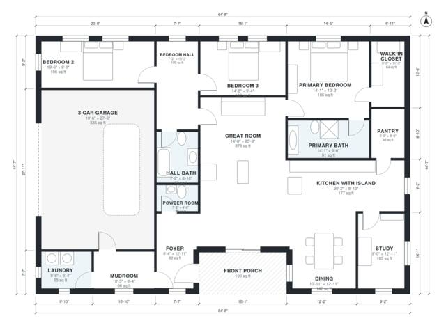

# Ranch House Plans With 3 Car Garage: 2,200 Sq Ft, 3 Bed

A single-story split-plan ranch of about 203 m² (2,200 sq ft) of living space, plus a 56 m² three-car garage and a front porch. The primary suite sits on one side of the great room and two bedrooms with a hall bath on the other. The island kitchen with walk-in pantry opens to the dining area and great room, and the mudroom and laundry sit between the garage and the house. The revision tidies up the entry and garage links and rebalances room sizes so the small rooms are not squeezed.

| | |
|---|---|
| Levels | 1 |
| Footprint | 19.7 m × 13.6 m (65 ft × 45 ft) |
| Rooms | 17 indoor, 1 outdoor |
| Indoor area including garage, from the room grid | about 258 m² (2,775 sq ft) |

## Files here

- `area-schedule.csv` (room schedule)
- `building.json` (rooms, walls, openings as data)
- `plan-level1.dxf` (floor plan, DXF, drawing units: inches)

## More for this plan

- Plan page with the PDF plan set, IFC and 3D model, and a tool to change the plan: https://floorplan.ai-architectures.com/house-plans/ranch-house-plans-with-3-car-garage?utm_source=github-plans&utm_medium=probe&utm_campaign=github
- PDF plan set: https://storage.googleapis.com/20img/house-plans/ranch-house-plans-with-3-car-garage/plan-set.pdf
- IFC model: https://storage.googleapis.com/20img/house-plans/ranch-house-plans-with-3-car-garage/model.ifc

## Known issues in this drawing

- Bedroom 2 is only 2.44 m wide.

Concept design generated with AI. Not for construction or permit; verify with a licensed professional.
