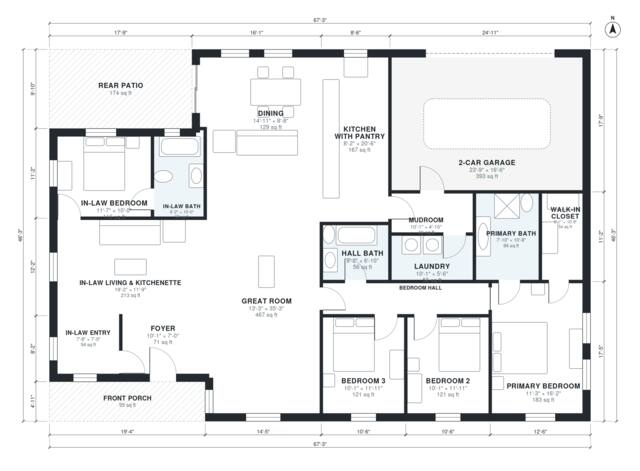

# Ranch House Plans With In Law Suite: 4 Bed 3 Bath 2,400 Sq Ft

A single-story ranch of about 232 m² (2,500 sq ft) of living space, or about 290 m² including the garage, porch and patio. The main house has an open great room, kitchen and dining area, and a bedroom hall serving a primary suite and two bedrooms. The revised in-law suite has its own entry off the porch, a living room with kitchenette, a bedroom and a bath, and it is separated from the main house.

| | |
|---|---|
| Levels | 1 |
| Footprint | 20.5 m × 14.1 m (67 ft × 46 ft) |
| Rooms | 18 indoor, 2 outdoor |
| Indoor area including garage, from the room grid | about 264 m² (2,842 sq ft) |

## Files here

- `area-schedule.csv` (room schedule)
- `building.json` (rooms, walls, openings as data)
- `plan-level1.dxf` (floor plan, DXF, drawing units: inches)

## More for this plan

- Plan page with the PDF plan set, IFC and 3D model, and a tool to change the plan: https://floorplan.ai-architectures.com/house-plans/ranch-house-plans-with-in-law-suite?utm_source=github-plans&utm_medium=probe&utm_campaign=github
- PDF plan set: https://storage.googleapis.com/20img/house-plans/ranch-house-plans-with-in-law-suite/plan-set.pdf
- IFC model: https://storage.googleapis.com/20img/house-plans/ranch-house-plans-with-in-law-suite/model.ifc

## Known issues in this drawing

- In-Law Bedroom is 10.8 m² (asked for about 16.0 m²).

Concept design generated with AI. Not for construction or permit; verify with a licensed professional.
