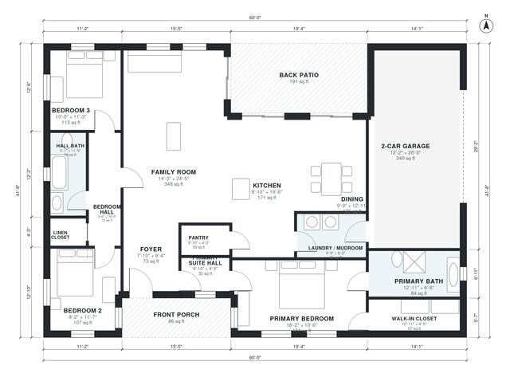

# Ranch House Plans: 3-Bed, 2-Bath Split Layout, 1,810 Sq Ft

This is a single-story classic ranch of roughly 1,880 sq ft of heated space. With the 2-car garage, front porch and back patio, the footprint is about 60 x 42 ft. The open kitchen, dining and family room sit in the centre, with the primary suite and walk-in closet on one side and two bedrooms sharing a hall bath on the other. The garage enters through the laundry/mudroom, and the back patio opens off the dining area.

| | |
|---|---|
| Levels | 1 |
| Footprint | 18.3 m × 12.7 m (60 ft × 42 ft) |
| Rooms | 16 indoor, 2 outdoor |
| Indoor area including garage, from the room grid | about 207 m² (2,225 sq ft) |

## Files here

- `area-schedule.csv` (room schedule)
- `building.json` (rooms, walls, openings as data)
- `plan-level1.dxf` (floor plan, DXF, drawing units: inches)

## More for this plan

- Plan page with the PDF plan set, IFC and 3D model, and a tool to change the plan: https://floorplan.ai-architectures.com/house-plans/ranch-house-plans?utm_source=github-plans&utm_medium=probe&utm_campaign=github
- PDF plan set: https://storage.googleapis.com/20img/house-plans/ranch-house-plans/plan-set.pdf
- IFC model: https://storage.googleapis.com/20img/house-plans/ranch-house-plans/model.ifc

## Known issues in this drawing

- None found by the automatic checks.

Concept design generated with AI. Not for construction or permit; verify with a licensed professional.
