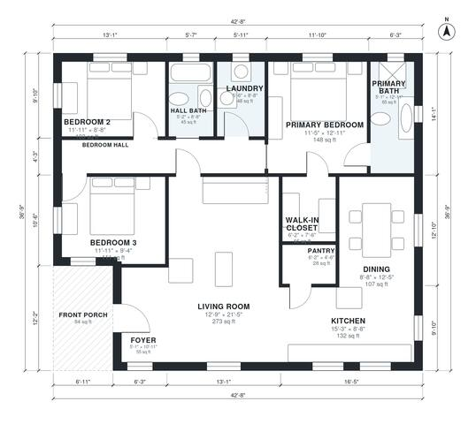

# Rectangular House Plans: 3-Bed, 2-Bath, 1,480 Sq Ft Plan

This is a simple single-story rectangular ranch of about 1,500 sq ft (about 139 m²) of living space, plus an 84 sq ft covered front porch. The front of the house holds an open kitchen, dining and living area. A central hall leads to two secondary bedrooms, a hall bath and the laundry, and the primary suite with its bath and walk-in closet sits at the far end. There is no garage, as requested.

| | |
|---|---|
| Levels | 1 |
| Footprint | 13.0 m × 11.2 m (43 ft × 37 ft) |
| Rooms | 13 indoor, 1 outdoor |
| Indoor area including garage, from the room grid | about 138 m² (1,484 sq ft) |

## Files here

- `area-schedule.csv` (room schedule)
- `building.json` (rooms, walls, openings as data)
- `plan-level1.dxf` (floor plan, DXF, drawing units: inches)

## More for this plan

- Plan page with the PDF plan set, IFC and 3D model, and a tool to change the plan: https://floorplan.ai-architectures.com/house-plans/rectangular-house-plans?utm_source=github-plans&utm_medium=probe&utm_campaign=github
- PDF plan set: https://storage.googleapis.com/20img/house-plans/rectangular-house-plans/plan-set.pdf
- IFC model: https://storage.googleapis.com/20img/house-plans/rectangular-house-plans/model.ifc

## Known issues in this drawing

- None found by the automatic checks.

Concept design generated with AI. Not for construction or permit; verify with a licensed professional.
