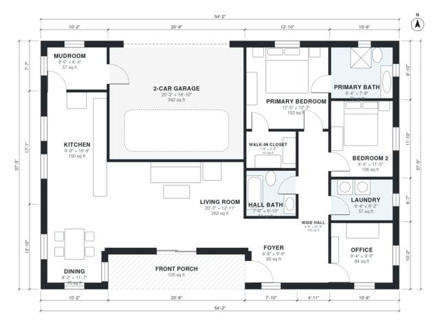

# Retirement House Plans: 1,540 Sq Ft One-Story, 2 Bed, 2 Bath

A step-free single-storey ranch of about 190 m² overall, with roughly 135 m² (about 1,450 sq ft) of living space plus a 2-car garage and front porch. It has an open kitchen, dining and living area, a wide central hall serving two bedrooms, a hall bath and an office, and a primary suite with ensuite and laundry beside it. The garage enters through a mudroom into the kitchen. The revision gives each bedroom its own door off the hall and removes the walk-in closet that forced Bedroom 2 to be entered through the primary suite.

| | |
|---|---|
| Levels | 1 |
| Footprint | 16.5 m × 11.4 m (54 ft × 37 ft) |
| Rooms | 14 indoor, 1 outdoor |
| Indoor area including garage, from the room grid | about 178 m² (1,916 sq ft) |

## Files here

- `area-schedule.csv` (room schedule)
- `building.json` (rooms, walls, openings as data)
- `plan-level1.dxf` (floor plan, DXF, drawing units: inches)

## More for this plan

- Plan page with the PDF plan set, IFC and 3D model, and a tool to change the plan: https://floorplan.ai-architectures.com/house-plans/retirement-house-plans?utm_source=github-plans&utm_medium=probe&utm_campaign=github
- PDF plan set: https://storage.googleapis.com/20img/house-plans/retirement-house-plans/plan-set.pdf
- IFC model: https://storage.googleapis.com/20img/house-plans/retirement-house-plans/model.ifc

## Known issues in this drawing

- Dining is only 2.50 m wide.
- Kitchen is only 2.74 m wide.

Concept design generated with AI. Not for construction or permit; verify with a licensed professional.
