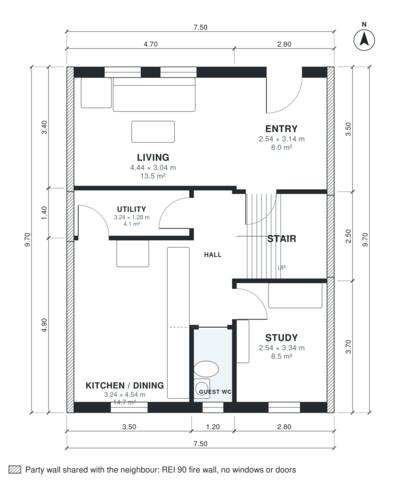

# Row House 4 Bedroom Plan: 1,570 Sq Ft, 2 Stories, 2.5 Bath

This is a 7.5 m wide mid-terrace house of about 145 m² over two floors, with party walls on both sides and windows only front and rear. The ground floor has a front living room, an open kitchen/dining area at the rear, a study, a guest WC and a utility room. Upstairs are four bedrooms, a family bath and a primary ensuite off a central hall. The revision trims circulation to give the living room and kitchen/dining area more space and the bedrooms and ensuite more usable proportions. Built against the neighbours on the left and right (party walls, fire wall without windows or doors); the rooms take their daylight from the free sides.

| | |
|---|---|
| Levels | 2 |
| Footprint | 7.5 m × 9.7 m (25 ft × 32 ft) |
| Rooms | 16 indoor, 0 outdoor |
| Indoor area including garage, from the room grid | about 146 m² (1,566 sq ft) |

## Files here

- `area-schedule.csv` (room schedule)
- `building.json` (rooms, walls, openings as data)
- `plan-level1.dxf` (floor plan, DXF, drawing units: millimetres)
- `plan-level2.dxf` (floor plan, DXF, drawing units: millimetres)

## More for this plan

- Plan page with the PDF plan set, IFC and 3D model, and a tool to change the plan: https://floorplan.ai-architectures.com/house-plans/row-house-4-bedroom?utm_source=github-plans&utm_medium=probe&utm_campaign=github
- PDF plan set: https://storage.googleapis.com/20img/house-plans/row-house-4-bedroom/plan-set.pdf
- IFC model: https://storage.googleapis.com/20img/house-plans/row-house-4-bedroom/model.ifc

## Known issues in this drawing

- Living is 13.5 m² (asked for about 20.0 m²).
- Living is only 3.04 m wide.

Concept design generated with AI. Not for construction or permit; verify with a licensed professional.
