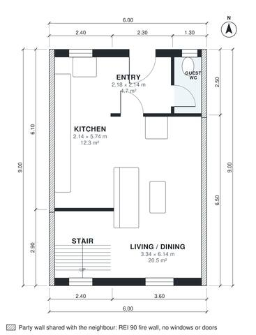

# Row House Plans: 3-Bed Two-Story Mid-Terrace, 1,160 Sq Ft

A 6 m wide mid-terrace house of about 108 m² on two floors, with windows only on the front and rear. The ground floor has the entry, guest WC, kitchen and an open living/dining room facing the garden. Upstairs, a central landing serves three bedrooms and a bath. The revision moves the kitchen to the front facade so it gets daylight. Built against the neighbours on the left and right (party walls, fire wall without windows or doors); the rooms take their daylight from the free sides.

| | |
|---|---|
| Levels | 2 |
| Footprint | 6.0 m × 9.0 m (20 ft × 30 ft) |
| Rooms | 11 indoor, 0 outdoor |
| Indoor area including garage, from the room grid | about 108 m² (1,163 sq ft) |

## Files here

- `area-schedule.csv` (room schedule)
- `building.json` (rooms, walls, openings as data)
- `plan-level1.dxf` (floor plan, DXF, drawing units: millimetres)
- `plan-level2.dxf` (floor plan, DXF, drawing units: millimetres)

## More for this plan

- Plan page with the PDF plan set, IFC and 3D model, and a tool to change the plan: https://floorplan.ai-architectures.com/house-plans/row-house-plans?utm_source=github-plans&utm_medium=probe&utm_campaign=github
- PDF plan set: https://storage.googleapis.com/20img/house-plans/row-house-plans/plan-set.pdf
- IFC model: https://storage.googleapis.com/20img/house-plans/row-house-plans/model.ifc

## Known issues in this drawing

- Kitchen is only 2.14 m wide.

Concept design generated with AI. Not for construction or permit; verify with a licensed professional.
