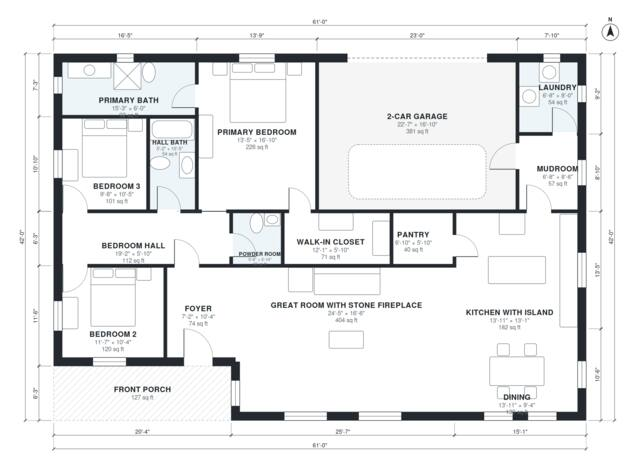

# Rustic House Plans: 3-Bed, 2.5-Bath Single-Story, 2,020 Sq Ft

This is a single-story rustic home with about 185 m² (2,000 sq ft) of living space in a 61 x 42 ft footprint, plus a 2-car garage and a covered front porch. The open great room with its stone fireplace flows into the island kitchen and dining area. The three bedrooms sit in a private wing off a hall, with a primary suite that has an ensuite bath and walk-in closet. The mudroom connects the garage, laundry and kitchen.

| | |
|---|---|
| Levels | 1 |
| Footprint | 18.6 m × 12.8 m (61 ft × 42 ft) |
| Rooms | 16 indoor, 1 outdoor |
| Indoor area including garage, from the room grid | about 226 m² (2,436 sq ft) |

## Files here

- `area-schedule.csv` (room schedule)
- `building.json` (rooms, walls, openings as data)
- `plan-level1.dxf` (floor plan, DXF, drawing units: inches)

## More for this plan

- Plan page with the PDF plan set, IFC and 3D model, and a tool to change the plan: https://floorplan.ai-architectures.com/house-plans/rustic-house-plans?utm_source=github-plans&utm_medium=probe&utm_campaign=github
- PDF plan set: https://storage.googleapis.com/20img/house-plans/rustic-house-plans/plan-set.pdf
- IFC model: https://storage.googleapis.com/20img/house-plans/rustic-house-plans/model.ifc

## Known issues in this drawing

- Bedroom 3 is 9.3 m² (asked for about 13.0 m²).

Concept design generated with AI. Not for construction or permit; verify with a licensed professional.
