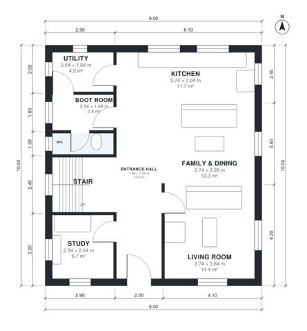

# Self Build House Plans: 4 Bed Two-Story Home, 1,940 Sq Ft

A compact two-storey house on a simple 9 x 10 m rectangle with about 180 m² of living space and no garage or basement. The ground floor has an open kitchen and family/dining room, a separate living room, a study, a WC, a utility and a boot room off the entrance hall. Upstairs, four bedrooms and a family bathroom open off one landing, and the primary bedroom has its own en-suite.

| | |
|---|---|
| Levels | 2 |
| Footprint | 9.0 m × 10.0 m (30 ft × 33 ft) |
| Rooms | 17 indoor, 0 outdoor |
| Indoor area including garage, from the room grid | about 180 m² (1,938 sq ft) |

## Files here

- `area-schedule.csv` (room schedule)
- `building.json` (rooms, walls, openings as data)
- `plan-level1.dxf` (floor plan, DXF, drawing units: millimetres)
- `plan-level2.dxf` (floor plan, DXF, drawing units: millimetres)

## More for this plan

- Plan page with the PDF plan set, IFC and 3D model, and a tool to change the plan: https://floorplan.ai-architectures.com/house-plans/self-build-house-plans?utm_source=github-plans&utm_medium=probe&utm_campaign=github
- PDF plan set: https://storage.googleapis.com/20img/house-plans/self-build-house-plans/plan-set.pdf
- IFC model: https://storage.googleapis.com/20img/house-plans/self-build-house-plans/model.ifc

## Known issues in this drawing

- Entrance Hall and WC are not directly connected.
- Family & Dining is 12.3 m² (asked for about 26.0 m²).
- Kitchen is only 2.04 m wide.

Concept design generated with AI. Not for construction or permit; verify with a licensed professional.
