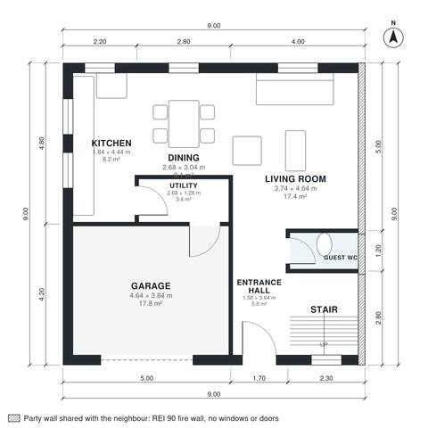

# Semi Detached House Plans with Garage: 4 Bed, 1,520 Sq Ft

A compact two-storey semi-detached house with the party wall on the right and a 1-car garage on the open left side. The ground floor has an open kitchen, dining and living area, a guest WC and a utility room that links to the garage. Upstairs are four bedrooms, a family bath and a primary ensuite off a landing. Living area is about 140 m² (1,505 sq ft), not counting the garage. Built against the neighbours on the right (party wall, fire wall without windows or doors); the rooms take their daylight from the free sides.

| | |
|---|---|
| Levels | 2 |
| Footprint | 9.0 m × 9.0 m (30 ft × 30 ft) |
| Rooms | 16 indoor, 0 outdoor |
| Indoor area including garage, from the room grid | about 162 m² (1,744 sq ft) |

## Files here

- `area-schedule.csv` (room schedule)
- `building.json` (rooms, walls, openings as data)
- `plan-level1.dxf` (floor plan, DXF, drawing units: millimetres)
- `plan-level2.dxf` (floor plan, DXF, drawing units: millimetres)

## More for this plan

- Plan page with the PDF plan set, IFC and 3D model, and a tool to change the plan: https://floorplan.ai-architectures.com/house-plans/semi-detached-house-plans-with-garage?utm_source=github-plans&utm_medium=probe&utm_campaign=github
- PDF plan set: https://storage.googleapis.com/20img/house-plans/semi-detached-house-plans-with-garage/plan-set.pdf
- IFC model: https://storage.googleapis.com/20img/house-plans/semi-detached-house-plans-with-garage/model.ifc

## Known issues in this drawing

- Kitchen is only 1.84 m wide.
- Bedroom 4 is only 2.44 m wide.

Concept design generated with AI. Not for construction or permit; verify with a licensed professional.
