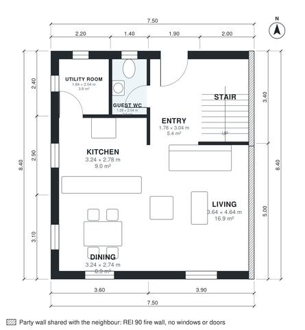

# Semi Detached House Plans: 3 Bed, 2.5 Bath, 1,360 Sq Ft

This is one half of a two-storey semi-detached pair, 7.5 m wide and 8.4 m deep, with about 126 m² over two floors and a windowless party wall on the right. Downstairs, the entry opens into an open living, dining and kitchen area facing the garden, with a guest WC and a utility room tucked beside the stair. Upstairs, three bedrooms, a family bath and a primary ensuite open off a central landing. Built against the neighbours on the right (party wall, fire wall without windows or doors); the rooms take their daylight from the free sides.

| | |
|---|---|
| Levels | 2 |
| Footprint | 7.5 m × 8.4 m (25 ft × 28 ft) |
| Rooms | 14 indoor, 0 outdoor |
| Indoor area including garage, from the room grid | about 126 m² (1,356 sq ft) |

## Files here

- `area-schedule.csv` (room schedule)
- `building.json` (rooms, walls, openings as data)
- `plan-level1.dxf` (floor plan, DXF, drawing units: millimetres)
- `plan-level2.dxf` (floor plan, DXF, drawing units: millimetres)

## More for this plan

- Plan page with the PDF plan set, IFC and 3D model, and a tool to change the plan: https://floorplan.ai-architectures.com/house-plans/semi-detached-house-plans?utm_source=github-plans&utm_medium=probe&utm_campaign=github
- PDF plan set: https://storage.googleapis.com/20img/house-plans/semi-detached-house-plans/plan-set.pdf
- IFC model: https://storage.googleapis.com/20img/house-plans/semi-detached-house-plans/model.ifc

## Known issues in this drawing

- Bedroom 3 is 6.2 m² (asked for about 10.0 m²).

Concept design generated with AI. Not for construction or permit; verify with a licensed professional.
