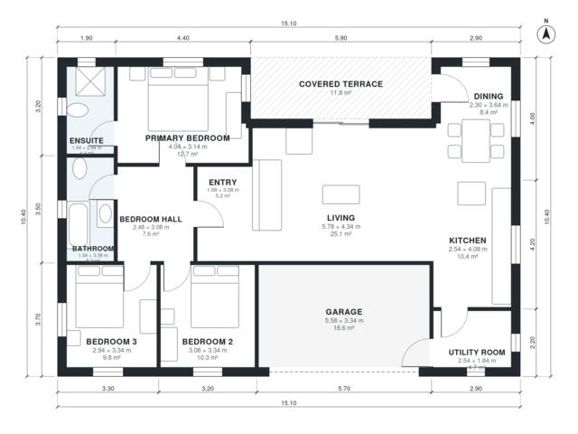

# Shed Roof House Plans: 3-Bed, 2-Bath Modern, 1,340 Sq Ft

A compact single-storey modern home of about 157 m² including the garage and covered terrace, with roughly 125 m² of living space. The open kitchen, dining and living area faces south under the shed roof, with the covered terrace alongside. Three bedrooms, a shared bath and a primary ensuite sit in a quiet wing off a central hall, and the 1-car garage connects through the utility room.

| | |
|---|---|
| Levels | 1 |
| Footprint | 15.1 m × 10.4 m (50 ft × 34 ft) |
| Rooms | 12 indoor, 1 outdoor |
| Indoor area including garage, from the room grid | about 145 m² (1,563 sq ft) |

## Files here

- `area-schedule.csv` (room schedule)
- `building.json` (rooms, walls, openings as data)
- `plan-level1.dxf` (floor plan, DXF, drawing units: millimetres)

## More for this plan

- Plan page with the PDF plan set, IFC and 3D model, and a tool to change the plan: https://floorplan.ai-architectures.com/house-plans/shed-roof-house-plans?utm_source=github-plans&utm_medium=probe&utm_campaign=github
- PDF plan set: https://storage.googleapis.com/20img/house-plans/shed-roof-house-plans/plan-set.pdf
- IFC model: https://storage.googleapis.com/20img/house-plans/shed-roof-house-plans/model.ifc

## Known issues in this drawing

- Dining is 8.4 m² (asked for about 12.0 m²).
- Dining is only 2.30 m wide.

Concept design generated with AI. Not for construction or permit; verify with a licensed professional.
