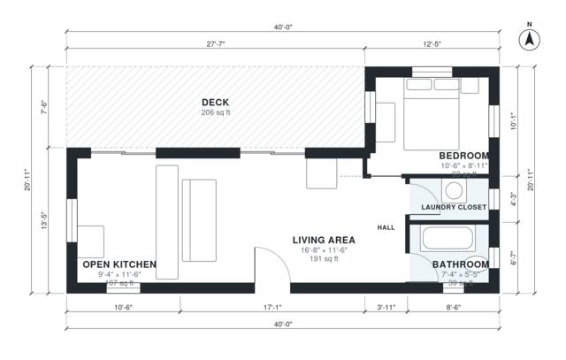

# Shipping Container House Plans: 630 Sq Ft 1 Bed, 1 Bath Home

This is a 640 sq ft (about 59.5 m²) two-container home. The entrance opens into an open kitchen and living area. A short hall at the end leads to the bedroom, bath and laundry closet. A 1.5 m deep deck runs the full long side and opens from the living area through sliding doors. The kitchen and bath came out slightly smaller than first sized, and we can adjust them if you want.

| | |
|---|---|
| Levels | 1 |
| Footprint | 12.19 m × 6.38 m (40 ft × 21 ft) |
| Rooms | 6 indoor, 1 outdoor |
| Indoor area including garage, from the room grid | about 59 m² (631 sq ft) |

## Files here

- `area-schedule.csv` (room schedule)
- `building.json` (rooms, walls, openings as data)
- `plan-level1.dxf` (floor plan, DXF, drawing units: inches)

## More for this plan

- Plan page with the PDF plan set, IFC and 3D model, and a tool to change the plan: https://floorplan.ai-architectures.com/house-plans/shipping-container-house-plans?utm_source=github-plans&utm_medium=probe&utm_campaign=github
- PDF plan set: https://storage.googleapis.com/20img/house-plans/shipping-container-house-plans/plan-set.pdf
- IFC model: https://storage.googleapis.com/20img/house-plans/shipping-container-house-plans/model.ifc

## Known issues in this drawing

- None found by the automatic checks.

Concept design generated with AI. Not for construction or permit; verify with a licensed professional.
