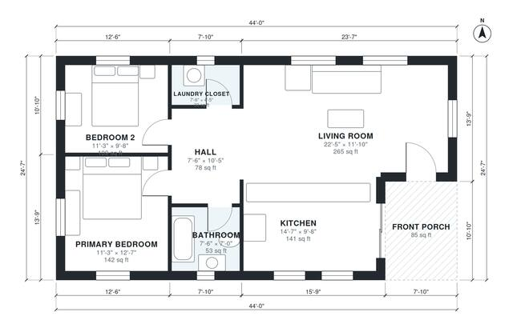

# Simple House Plans: 2 Bed, 1 Bath, 1,000 Sq Ft Single Story

This is a compact single-story 2-bedroom, 1-bath cottage of about 92 m² (roughly 1,000 sq ft) of living space, plus an 8 m² front porch. The front door opens into a large open living and kitchen area. A central hall leads to the primary bedroom, the second bedroom, the bath and a laundry closet. All main rooms have exterior windows.

| | |
|---|---|
| Levels | 1 |
| Footprint | 13.4 m × 7.5 m (44 ft × 25 ft) |
| Rooms | 7 indoor, 1 outdoor |
| Indoor area including garage, from the room grid | about 93 m² (997 sq ft) |

## Files here

- `area-schedule.csv` (room schedule)
- `building.json` (rooms, walls, openings as data)
- `plan-level1.dxf` (floor plan, DXF, drawing units: inches)

## More for this plan

- Plan page with the PDF plan set, IFC and 3D model, and a tool to change the plan: https://floorplan.ai-architectures.com/house-plans/simple-house-plans?utm_source=github-plans&utm_medium=probe&utm_campaign=github
- PDF plan set: https://storage.googleapis.com/20img/house-plans/simple-house-plans/plan-set.pdf
- IFC model: https://storage.googleapis.com/20img/house-plans/simple-house-plans/model.ifc

## Known issues in this drawing

- None found by the automatic checks.

Concept design generated with AI. Not for construction or permit; verify with a licensed professional.
