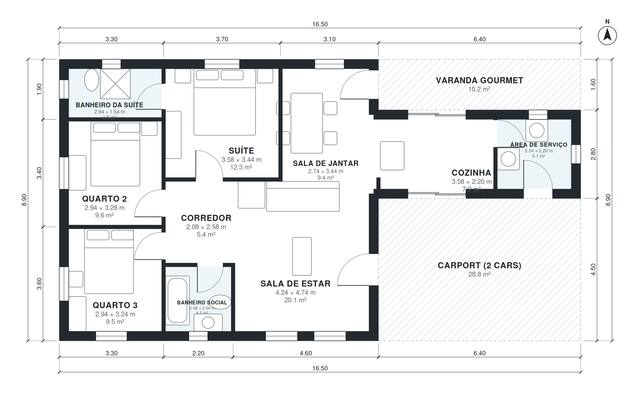

# Single Story House Plans With Suite | 3 Bed, 1,160 Sq Ft

This is a single-story casa térrea of about 108 m² of living space, plus a covered 2-car carport and a 10 m² gourmet balcony. The living room opens to the dining area and kitchen and onto the balcony, and the entry is straight from the carport. The bedroom wing has a suite with a private bath and two bedrooms sharing a bath, and a service area sits beside the kitchen.

| | |
|---|---|
| Levels | 1 |
| Footprint | 16.5 m × 8.9 m (54 ft × 29 ft) |
| Rooms | 10 indoor, 2 outdoor |
| Indoor area including garage, from the room grid | about 108 m² (1,160 sq ft) |

## Files here

- `area-schedule.csv` (room schedule)
- `building.json` (rooms, walls, openings as data)
- `plan-level1.dxf` (floor plan, DXF, drawing units: millimetres)

## More for this plan

- Plan page with the PDF plan set, IFC and 3D model, and a tool to change the plan: https://floorplan.ai-architectures.com/house-plans/single-story-house-plans-with-suite?utm_source=github-plans&utm_medium=probe&utm_campaign=github
- PDF plan set: https://storage.googleapis.com/20img/house-plans/single-story-house-plans-with-suite/plan-set.pdf
- IFC model: https://storage.googleapis.com/20img/house-plans/single-story-house-plans-with-suite/model.ifc

## Known issues in this drawing

- Cozinha is 7.9 m² (asked for about 12.0 m²).
- Cozinha is only 2.20 m wide.

Concept design generated with AI. Not for construction or permit; verify with a licensed professional.
