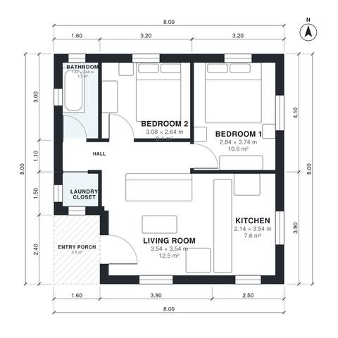

# Small 2 Bedroom House Plans 60 m2: 650 Sq Ft, 1 Bath Plan

This is a compact single-storey home of about 60 m² indoors, plus a covered entry porch, on an 8 x 8 m footprint. The front door opens into an open living room and kitchen. A central hall leads to two bedrooms, a bathroom and a laundry closet. Every room has a window, and the layout is efficient with no wasted circulation.

| | |
|---|---|
| Levels | 1 |
| Footprint | 8.0 m × 8.0 m (26 ft × 26 ft) |
| Rooms | 7 indoor, 1 outdoor |
| Indoor area including garage, from the room grid | about 60 m² (648 sq ft) |

## Files here

- `area-schedule.csv` (room schedule)
- `building.json` (rooms, walls, openings as data)
- `plan-level1.dxf` (floor plan, DXF, drawing units: millimetres)

## More for this plan

- Plan page with the PDF plan set, IFC and 3D model, and a tool to change the plan: https://floorplan.ai-architectures.com/house-plans/small-2-bedroom-house-plans-60-m2?utm_source=github-plans&utm_medium=probe&utm_campaign=github
- PDF plan set: https://storage.googleapis.com/20img/house-plans/small-2-bedroom-house-plans-60-m2/plan-set.pdf
- IFC model: https://storage.googleapis.com/20img/house-plans/small-2-bedroom-house-plans-60-m2/model.ifc

## Known issues in this drawing

- Kitchen is only 2.14 m wide.
- Bathroom is 3.3 m² (asked for about 4.5 m²).
- Bathroom is only 1.24 m wide.

Concept design generated with AI. Not for construction or permit; verify with a licensed professional.
