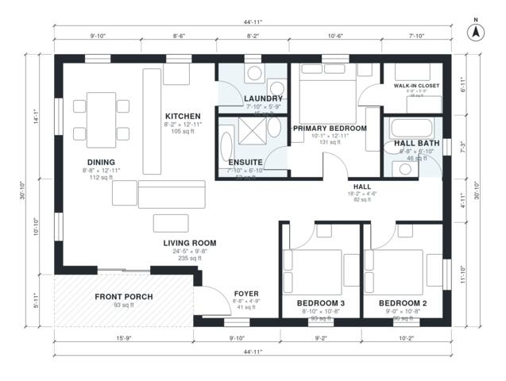

# Small 3 Bedroom Craftsman House Plans: 1,290 Sq Ft Ranch

This is a single-storey craftsman home with about 120 m² (roughly 1,300 sq ft) of living space, plus a covered front porch. The living room sits at the front. The kitchen, dining and living areas are open to each other, with the laundry off the kitchen. Three bedrooms sit along a short hall with a hall bath, and the primary suite has its own ensuite and walk-in closet.

| | |
|---|---|
| Levels | 1 |
| Footprint | 13.7 m × 9.4 m (45 ft × 31 ft) |
| Rooms | 12 indoor, 1 outdoor |
| Indoor area including garage, from the room grid | about 120 m² (1,293 sq ft) |

## Files here

- `area-schedule.csv` (room schedule)
- `building.json` (rooms, walls, openings as data)
- `plan-level1.dxf` (floor plan, DXF, drawing units: inches)

## More for this plan

- Plan page with the PDF plan set, IFC and 3D model, and a tool to change the plan: https://floorplan.ai-architectures.com/house-plans/small-3-bedroom-craftsman-house-plans?utm_source=github-plans&utm_medium=probe&utm_campaign=github
- PDF plan set: https://storage.googleapis.com/20img/house-plans/small-3-bedroom-craftsman-house-plans/plan-set.pdf
- IFC model: https://storage.googleapis.com/20img/house-plans/small-3-bedroom-craftsman-house-plans/model.ifc

## Known issues in this drawing

- Living Room is only 2.94 m wide.

Concept design generated with AI. Not for construction or permit; verify with a licensed professional.
