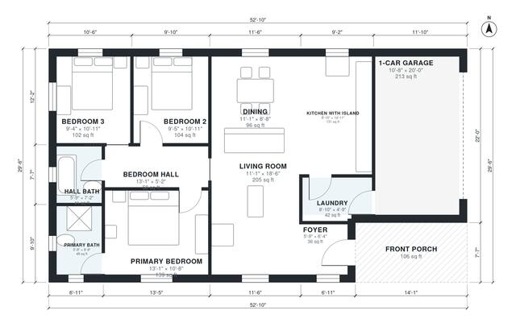

# Small 3 Bedroom Farmhouse Plans: 1,190 Sq Ft, 2 Bath, Garage

This single-story farmhouse offers about 125 m² (1,350 sq ft) of living space plus a 1-car garage and a front porch. The open kitchen, island, dining and living area sits in the centre. The three bedrooms are in a quiet wing off a short hall, with the primary suite and a shared hall bath. The garage enters through the laundry for easy unloading.

| | |
|---|---|
| Levels | 1 |
| Footprint | 16.1 m × 9.0 m (53 ft × 30 ft) |
| Rooms | 12 indoor, 1 outdoor |
| Indoor area including garage, from the room grid | about 135 m² (1,453 sq ft) |

## Files here

- `area-schedule.csv` (room schedule)
- `building.json` (rooms, walls, openings as data)
- `plan-level1.dxf` (floor plan, DXF, drawing units: inches)

## More for this plan

- Plan page with the PDF plan set, IFC and 3D model, and a tool to change the plan: https://floorplan.ai-architectures.com/house-plans/small-3-bedroom-farmhouse-plans?utm_source=github-plans&utm_medium=probe&utm_campaign=github
- PDF plan set: https://storage.googleapis.com/20img/house-plans/small-3-bedroom-farmhouse-plans/plan-set.pdf
- IFC model: https://storage.googleapis.com/20img/house-plans/small-3-bedroom-farmhouse-plans/model.ifc

## Known issues in this drawing

- Primary Bath is 4.6 m² (asked for about 6.5 m²).
- Foyer is 3.4 m² (asked for about 5.0 m²).

Concept design generated with AI. Not for construction or permit; verify with a licensed professional.
