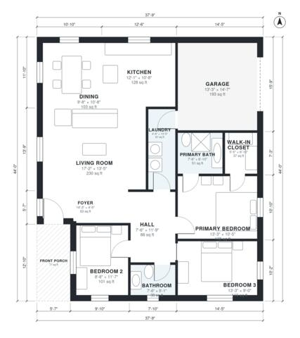

# Small 3 Bedroom Modern House Plans: 1,360 Sq Ft One-Story

This single-story modern home has about 1,350 sq ft of living space (125 m²), plus a 1-car garage and a front porch. The kitchen, dining and living areas are open-plan. The three bedrooms and two baths sit in a separate wing off a central hall, and the primary suite has an ensuite and a walk-in closet. The garage connects through the laundry, which serves as a back entry.

| | |
|---|---|
| Levels | 1 |
| Footprint | 11.5 m × 13.4 m (38 ft × 44 ft) |
| Rooms | 13 indoor, 1 outdoor |
| Indoor area including garage, from the room grid | about 147 m² (1,587 sq ft) |

## Files here

- `area-schedule.csv` (room schedule)
- `building.json` (rooms, walls, openings as data)
- `plan-level1.dxf` (floor plan, DXF, drawing units: inches)

## More for this plan

- Plan page with the PDF plan set, IFC and 3D model, and a tool to change the plan: https://floorplan.ai-architectures.com/house-plans/small-3-bedroom-modern-house-plans?utm_source=github-plans&utm_medium=probe&utm_campaign=github
- PDF plan set: https://storage.googleapis.com/20img/house-plans/small-3-bedroom-modern-house-plans/plan-set.pdf
- IFC model: https://storage.googleapis.com/20img/house-plans/small-3-bedroom-modern-house-plans/model.ifc

## Known issues in this drawing

- Bathroom is 3.5 m² (asked for about 5.0 m²).

Concept design generated with AI. Not for construction or permit; verify with a licensed professional.
