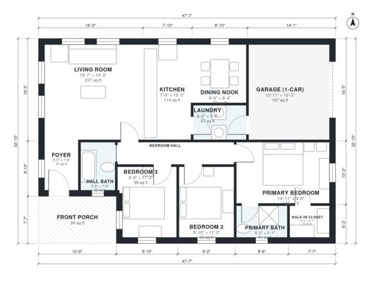

# Small 3 Bedroom Ranch House Plans: 1,240 Sq Ft, 2 Bath

This is a single-story ranch with a 14.5 x 10 m envelope. It has about 116 m² (1,250 sq ft) of living space, plus a 1-car garage and a covered front porch. The open kitchen, living room and dining nook sit at the front and back. A private bedroom wing holds three bedrooms, a primary suite with a walk-in closet and ensuite, and a hall bath. The garage enters through the laundry.

| | |
|---|---|
| Levels | 1 |
| Footprint | 14.5 m × 10.0 m (48 ft × 33 ft) |
| Rooms | 13 indoor, 1 outdoor |
| Indoor area including garage, from the room grid | about 136 m² (1,467 sq ft) |

## Files here

- `area-schedule.csv` (room schedule)
- `building.json` (rooms, walls, openings as data)
- `plan-level1.dxf` (floor plan, DXF, drawing units: inches)

## More for this plan

- Plan page with the PDF plan set, IFC and 3D model, and a tool to change the plan: https://floorplan.ai-architectures.com/house-plans/small-3-bedroom-ranch-house-plans?utm_source=github-plans&utm_medium=probe&utm_campaign=github
- PDF plan set: https://storage.googleapis.com/20img/house-plans/small-3-bedroom-ranch-house-plans/plan-set.pdf
- IFC model: https://storage.googleapis.com/20img/house-plans/small-3-bedroom-ranch-house-plans/model.ifc

## Known issues in this drawing

- Primary Bedroom is only 2.98 m wide.
- Dining Nook is only 2.58 m wide.

Concept design generated with AI. Not for construction or permit; verify with a licensed professional.
