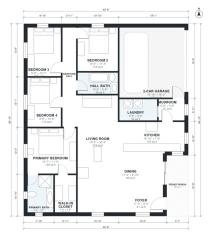

# Small 4 Bedroom House Plans: 1,690 Sq Ft Single Story

This is a single-story, 4-bedroom, 2-bath ranch of about 1,650 sq ft of living space, plus an attached 2-car garage and a covered front porch. The open kitchen, dining and living area sits in the middle. The primary suite with its bath and walk-in closet is on one side, and three bedrooms and a hall bath are on the other, off a single hall. The garage enters through a mudroom and laundry beside the kitchen.

| | |
|---|---|
| Levels | 1 |
| Footprint | 13.0 m × 15.2 m (43 ft × 50 ft) |
| Rooms | 15 indoor, 1 outdoor |
| Indoor area including garage, from the room grid | about 189 m² (2,039 sq ft) |

## Files here

- `area-schedule.csv` (room schedule)
- `building.json` (rooms, walls, openings as data)
- `plan-level1.dxf` (floor plan, DXF, drawing units: inches)

## More for this plan

- Plan page with the PDF plan set, IFC and 3D model, and a tool to change the plan: https://floorplan.ai-architectures.com/house-plans/small-4-bedroom-house-plans?utm_source=github-plans&utm_medium=probe&utm_campaign=github
- PDF plan set: https://storage.googleapis.com/20img/house-plans/small-4-bedroom-house-plans/plan-set.pdf
- IFC model: https://storage.googleapis.com/20img/house-plans/small-4-bedroom-house-plans/model.ifc

## Known issues in this drawing

- Living Room is only 3.18 m wide.
- 2-Car Garage is 28.5 m² (asked for about 38.0 m²).

Concept design generated with AI. Not for construction or permit; verify with a licensed professional.
