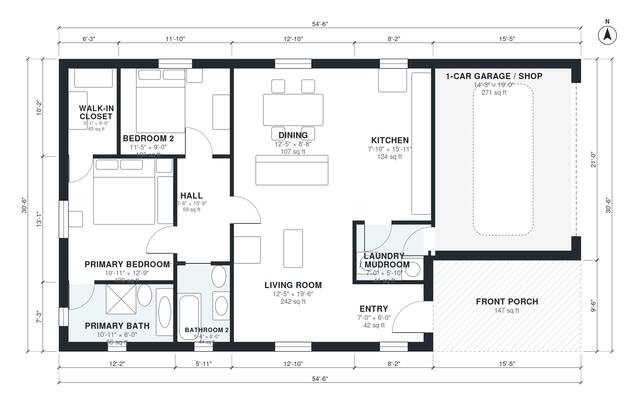

# Small Barndominium Floor Plans: 2 Bed, 2 Bath, 1,190 Sq Ft

This is a compact single-story barndominium of about 1,240 sq ft of living space, plus a 1-car garage/shop and a covered front porch. The open great room combines living, dining and kitchen, with the laundry/mudroom linking the kitchen to the garage. A short hall leads to a primary suite with its own bath and walk-in closet, and to a second bedroom and bath. The plan is a simple rectangle, which suits a metal building and a gable roof.

| | |
|---|---|
| Levels | 1 |
| Footprint | 16.6 m × 9.3 m (54 ft × 31 ft) |
| Rooms | 12 indoor, 1 outdoor |
| Indoor area including garage, from the room grid | about 141 m² (1,515 sq ft) |

## Files here

- `area-schedule.csv` (room schedule)
- `building.json` (rooms, walls, openings as data)
- `plan-level1.dxf` (floor plan, DXF, drawing units: inches)

## More for this plan

- Plan page with the PDF plan set, IFC and 3D model, and a tool to change the plan: https://floorplan.ai-architectures.com/house-plans/small-barndominium-floor-plans?utm_source=github-plans&utm_medium=probe&utm_campaign=github
- PDF plan set: https://storage.googleapis.com/20img/house-plans/small-barndominium-floor-plans/plan-set.pdf
- IFC model: https://storage.googleapis.com/20img/house-plans/small-barndominium-floor-plans/model.ifc

## Known issues in this drawing

- None found by the automatic checks.

Concept design generated with AI. Not for construction or permit; verify with a licensed professional.
