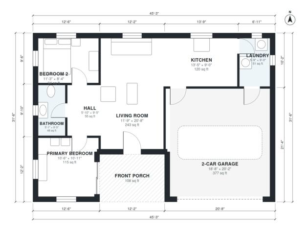

# Small Barndominium With Garage House Plan, 2 Bed, 880 Sq Ft

A compact single-storey barndominium of about 137 m² under one gable roof, with roughly 93 m² (1,000 sq ft) of conditioned living space plus a 2-car garage and a front porch. It has an open kitchen and living room, two bedrooms and a bath grouped off a short hall, and a laundry that links the kitchen to the garage. The revision widens the footprint slightly so both bedrooms and the garage reach their proper sizes.

| | |
|---|---|
| Levels | 1 |
| Footprint | 13.8 m × 9.6 m (45 ft × 31 ft) |
| Rooms | 8 indoor, 1 outdoor |
| Indoor area including garage, from the room grid | about 122 m² (1,318 sq ft) |

## Files here

- `area-schedule.csv` (room schedule)
- `building.json` (rooms, walls, openings as data)
- `plan-level1.dxf` (floor plan, DXF, drawing units: inches)

## More for this plan

- Plan page with the PDF plan set, IFC and 3D model, and a tool to change the plan: https://floorplan.ai-architectures.com/house-plans/small-barndominium-with-garage?utm_source=github-plans&utm_medium=probe&utm_campaign=github
- PDF plan set: https://storage.googleapis.com/20img/house-plans/small-barndominium-with-garage/plan-set.pdf
- IFC model: https://storage.googleapis.com/20img/house-plans/small-barndominium-with-garage/model.ifc

## Known issues in this drawing

- None found by the automatic checks.

Concept design generated with AI. Not for construction or permit; verify with a licensed professional.
