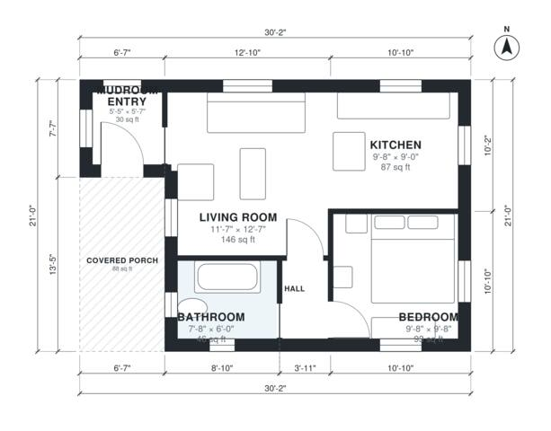

# Small Cabin Plans: 550 Sq Ft, 1 Bed, 1 Bath One-Story Cabin

This is a compact one-bedroom, one-bath cabin of about 550 sq ft (51 m²) of heated space, plus an 88 sq ft covered porch. You enter from the porch into a mudroom, then into a bright open living room and kitchen. A short hall leads to the private bedroom and full bath. The bedroom is on the small side, and the mudroom and bath are tight, so you could ask for a slightly larger footprint if you want more room.

| | |
|---|---|
| Levels | 1 |
| Footprint | 9.2 m × 6.4 m (30 ft × 21 ft) |
| Rooms | 6 indoor, 1 outdoor |
| Indoor area including garage, from the room grid | about 51 m² (546 sq ft) |

## Files here

- `area-schedule.csv` (room schedule)
- `building.json` (rooms, walls, openings as data)
- `plan-level1.dxf` (floor plan, DXF, drawing units: inches)

## More for this plan

- Plan page with the PDF plan set, IFC and 3D model, and a tool to change the plan: https://floorplan.ai-architectures.com/house-plans/small-cabin-plans?utm_source=github-plans&utm_medium=probe&utm_campaign=github
- PDF plan set: https://storage.googleapis.com/20img/house-plans/small-cabin-plans/plan-set.pdf
- IFC model: https://storage.googleapis.com/20img/house-plans/small-cabin-plans/model.ifc

## Known issues in this drawing

- Mudroom Entry is 2.8 m² (asked for about 4.5 m²).

Concept design generated with AI. Not for construction or permit; verify with a licensed professional.
