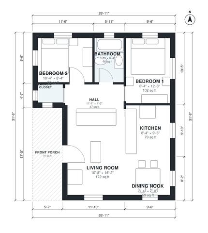

# Small Cottage House Plans: 2 Bed, 1 Bath, 750 Sq Ft Plan

This is a compact 850 sq ft single-level cottage with two bedrooms, one bath and a laundry closet, all off a central hall. The porch opens into an open living room, kitchen and dining nook, and every room has natural light. The layout is efficient and easy to walk through, and the porch depth or nook size can be adjusted if you want.

| | |
|---|---|
| Levels | 1 |
| Footprint | 8.2 m × 9.6 m (27 ft × 31 ft) |
| Rooms | 8 indoor, 1 outdoor |
| Indoor area including garage, from the room grid | about 70 m² (750 sq ft) |

## Files here

- `area-schedule.csv` (room schedule)
- `building.json` (rooms, walls, openings as data)
- `plan-level1.dxf` (floor plan, DXF, drawing units: inches)

## More for this plan

- Plan page with the PDF plan set, IFC and 3D model, and a tool to change the plan: https://floorplan.ai-architectures.com/house-plans/small-cottage-house-plans?utm_source=github-plans&utm_medium=probe&utm_campaign=github
- PDF plan set: https://storage.googleapis.com/20img/house-plans/small-cottage-house-plans/plan-set.pdf
- IFC model: https://storage.googleapis.com/20img/house-plans/small-cottage-house-plans/model.ifc

## Known issues in this drawing

- Laundry Closet is only 1.04 m wide.
- Dining Nook is only 2.14 m wide.
- Bedroom 1 is only 2.54 m wide.

Concept design generated with AI. Not for construction or permit; verify with a licensed professional.
