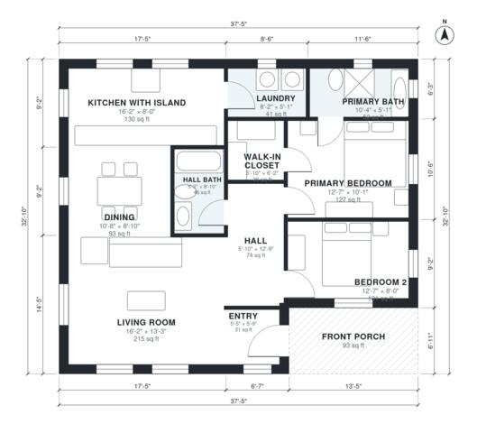

# Small Craftsman House Plans: 2 Bed, 2 Bath, 1,130 Sq Ft

This is a single-story craftsman home of about 114 m² (1,230 sq ft) overall, with roughly 105 m² (1,130 sq ft) of indoor living space plus a covered front porch. The living room sits at the front, and the open kitchen with island and dining area run along the back and side. A central hall serves a primary suite (ensuite and walk-in closet), a second bedroom and a hall bath, with the laundry tucked beside the kitchen.

| | |
|---|---|
| Levels | 1 |
| Footprint | 11.4 m × 10.0 m (37 ft × 33 ft) |
| Rooms | 11 indoor, 1 outdoor |
| Indoor area including garage, from the room grid | about 105 m² (1,134 sq ft) |

## Files here

- `area-schedule.csv` (room schedule)
- `building.json` (rooms, walls, openings as data)
- `plan-level1.dxf` (floor plan, DXF, drawing units: inches)

## More for this plan

- Plan page with the PDF plan set, IFC and 3D model, and a tool to change the plan: https://floorplan.ai-architectures.com/house-plans/small-craftsman-house-plans?utm_source=github-plans&utm_medium=probe&utm_campaign=github
- PDF plan set: https://storage.googleapis.com/20img/house-plans/small-craftsman-house-plans/plan-set.pdf
- IFC model: https://storage.googleapis.com/20img/house-plans/small-craftsman-house-plans/model.ifc

## Known issues in this drawing

- Entry is 2.9 m² (asked for about 4.0 m²).
- Bedroom 2 is only 2.44 m wide.

Concept design generated with AI. Not for construction or permit; verify with a licensed professional.
