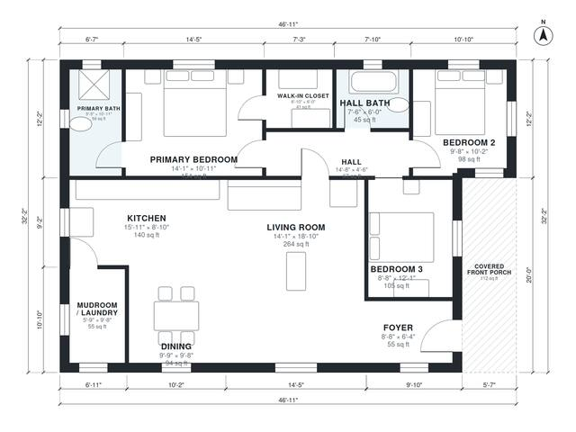

# Small Farmhouse Plans: 3-Bed, 2-Bath One-Story, 1,400 Sq Ft

A compact one-story modern farmhouse of about 15.7 × 8.8 m (about 1,400 sq ft heated, plus a covered front porch of about 110 sq ft) with a gable roof. A foyer off the porch opens into a bright open kitchen, dining and living area. A short hall serves three bedrooms and two baths, including a primary suite with a walk-in closet. The mudroom/laundry at the kitchen end gives an everyday side entrance.

| | |
|---|---|
| Levels | 1 |
| Footprint | 14.3 m × 9.8 m (47 ft × 32 ft) |
| Rooms | 12 indoor, 1 outdoor |
| Indoor area including garage, from the room grid | about 130 m² (1,397 sq ft) |

## Files here

- `area-schedule.csv` (room schedule)
- `building.json` (rooms, walls, openings as data)
- `plan-level1.dxf` (floor plan, DXF, drawing units: inches)

## More for this plan

- Plan page with the PDF plan set, IFC and 3D model, and a tool to change the plan: https://floorplan.ai-architectures.com/house-plans/small-farmhouse-plans?utm_source=github-plans&utm_medium=probe&utm_campaign=github
- PDF plan set: https://storage.googleapis.com/20img/house-plans/small-farmhouse-plans/plan-set.pdf
- IFC model: https://storage.googleapis.com/20img/house-plans/small-farmhouse-plans/model.ifc

## Known issues in this drawing

- None found by the automatic checks.

Concept design generated with AI. Not for construction or permit; verify with a licensed professional.
